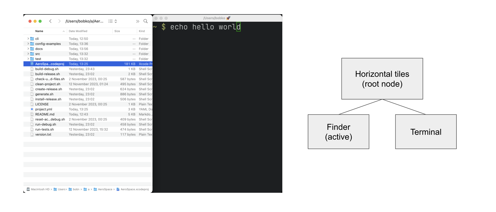
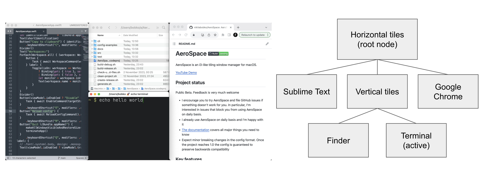
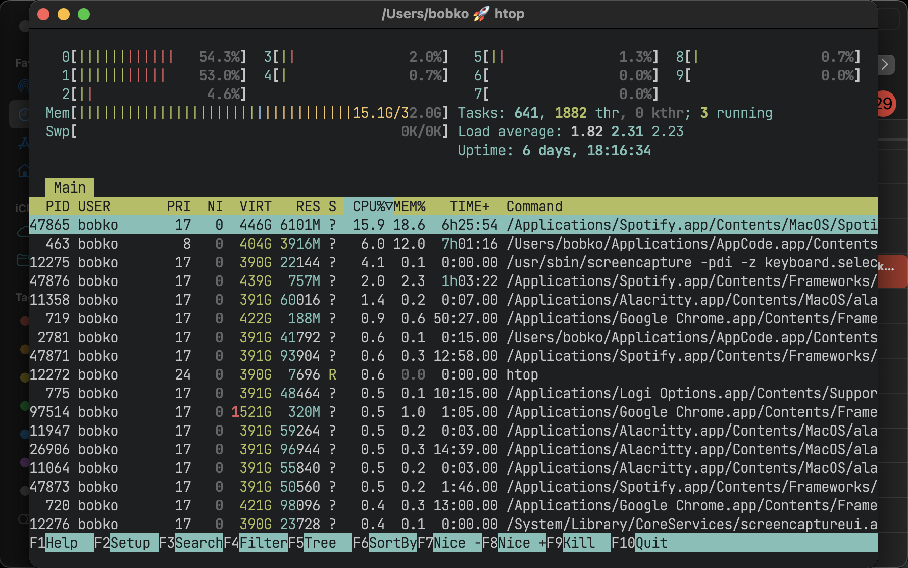
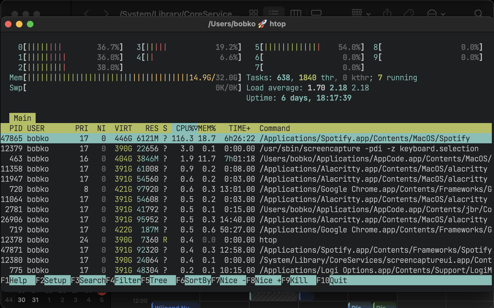
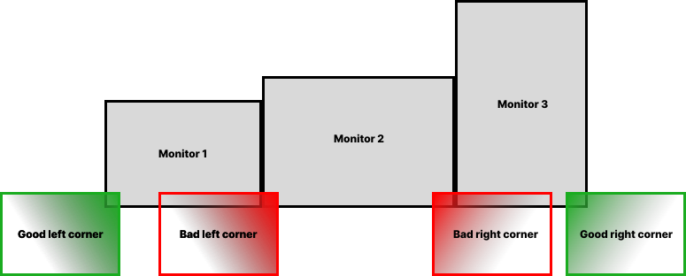
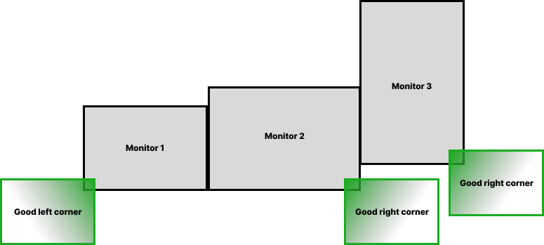
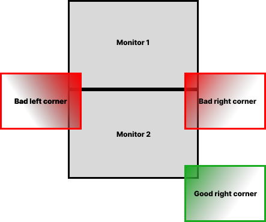
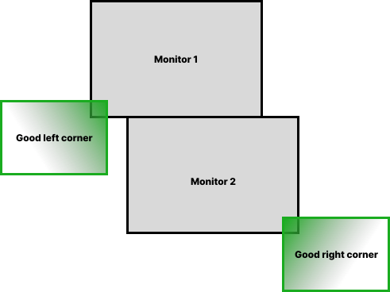

= HyprMac Guide
include::util/site-attributes.adoc[]
:url-search-for-config: https://github.com/search?q=path%3A*hyprmac.toml&type=code

include::util/header.adoc[]

This Guide is designed to be read from top to bottom as a whole.
You can skip parts that are obvious.

[#installation]
== Installation

[#homebrew-installation]
=== Homebrew installation (Preferred)

https://brew.sh/[Homebrew] is a package manager for macOS

[source,bash]
----
brew tap novaisvictor/tap
brew trust novaisvictor/tap
brew install --cask hyprmac
----

*(Optional)* You might need to configure your shell to enable completion provided by homebrew packages: https://docs.brew.sh/Shell-Completion
HyprMac provides bash, fish and zsh completions.

HyprMac releases are ad-hoc signed and not notarized.
macOS asks for the Accessibility permission again after every update, because the signature changes with each release.

[#manual-installation]
=== Manual installation

. Download the latest available zip from https://github.com/NovaisVictor/HyprMac/releases[releases page]
. Unpack zip
. Put unpacked `HyprMac-$VERSION/HyprMac.app` to `/Applications`
. Put unpacked `HyprMac-$VERSION/bin/hyprmac` anywhere to `$PATH`
(The step is optional. It is only needed if you want to be able to interact with HyprMac from CLI)

If you see this message

----
"HyprMac.app" can't be opened because Apple cannot check it for malicious software.
----

**Option 1** to resolve the problem

```
xattr -dr com.apple.quarantine /Applications/HyprMac.app
```

**Option 2** to resolve the problem

. navigate in Finder to `/Applications/HyprMac.app`
. Right mouse click
. Open (yes, it's that stupid)

[#configuring-hyprmac]
== Configuring HyprMac

[#config-location]
=== Custom config location

HyprMac tries to find the custom config in two locations:

. `~/.hyprmac.toml`
. `+${XDG_CONFIG_HOME}/hyprmac/hyprmac.toml+`
(environment variable `XDG_CONFIG_HOME` fallbacks to `~/.config` if the variable is not presented)

If the config is found in more than one location then the ambiguity is reported.

=== Config samples

Please see the following config samples:

* <<default-config,The default config>>
* xref:./goodies.adoc#i3-like-config[i3 like config]
* {url-search-for-config}[Search for configs by other users on GitHub] for inspiration

HyprMac uses TOML 1.1.0 format for the config.
See https://toml.io/en/v1.1.0[TOML spec for more info]

[#default-config]
=== Default config

The default config is part of the documentation, it contains all trivial configuration keys with comments.
Please read the default config!
Non-trivial configuration options are mentioned further in this guide.
If no custom config is found, HyprMac will load the default config.

If the key is omitted in the custom config, it falls back to the value in the default config, unless it's stated otherwise for the specific keys. Namely:

* `mode.*.binding`. It falls back to the empty TOML table. Your config is the source of truth for keyboard and <<mouse-bindings,mouse bindings>>. You must explicitly mention all the bindings and <<binding-modes,binding modes>> in your config.
* `on-focused-monitor-changed`. It falls back to the empty TOML array.
* `exec` TOML table. See: <<exec-env-vars>> (It's so boring and verbose, I don't even want to mention it in the `default-config.toml`)

Rule of thumb: all the "scalar like" values always fall back to the default config. All the "vector like" values fall back to the empty TOML array or table.

That allows you to keep your config tidy and clean from trivial config keys for which you like the default values.
You can bootstrap your custom config by copying the default config from the app installation:

[source,shell]
----
cp /Applications/HyprMac.app/Contents/Resources/default-config.toml ~/.hyprmac.toml
----

link:config-examples/default-config.toml[Download default-config.toml]

[source,toml,subs="macros+,specialchars+"]
----
include::config-examples/default-config.toml[]
----

[#binding-modes]
=== Binding modes

You can create multiple sets of bindings by creating different binding modes.
When you switch to a different binding mode, all the bindings from the current mode are deactivated, and only the bindings specified in the new mode become active.
The initial binding mode that HyprMac starts out with is "main".

This feature is absolutely identical to the one
https://i3wm.org/docs/userguide.html#binding_modes[in i3]

Working with binding modes consists of two parts:
1. defining a binding to switch to the binding mode and 2. declaring the binding mode itself.

[source,toml]
----
[mode.main.binding]            # Declare 'main' binding mode
    alt-r = 'mode resize'      # 1. Define a binding to switch to 'resize' mode

[mode.resize.binding]          # 2. Declare 'resize' binding mode
    minus = 'resize smart -50'
    equal = 'resize smart +50'
----

[#binding-triggers]
=== Release and repeat

By default, a binding runs its commands when the key is pressed, once.
The value of a binding can also be an inline table, which accepts the following keys:

`run`:: The commands. A string or an array of strings, the same as the plain value. Mandatory
`on`:: `'press'` (default) or `'release'`. With `'release'`, the commands run when the key is released
`repeat`:: `true` or `false` (default). With `true`, the commands run on press, and then repeatedly while the key is held.
The repeat follows the key repeat settings of macOS (System Settings -> Keyboard -> Key repeat rate and Delay until repeat).
Incompatible with `on = 'release'`

[source,toml]
----
[mode.main.binding]
    alt-x = { run = 'layout tiles horizontal vertical', on = 'release' }

[mode.resize.binding]
    minus = { run = 'resize smart -50', repeat = true }
    equal = { run = 'resize smart +50', repeat = true }
----

* A release binding runs only if its key was pressed in the same <<binding-modes,binding mode>>.
E.g. the release of `alt-r = 'mode resize'` doesn't trigger an `alt-r` release binding of the `resize` mode.
* The repeat stops when the key is released, when the binding mode changes, when the config is reloaded,
or when a modifier of the binding is released.
* xref:commands.adoc#trigger-binding[trigger-binding] runs the commands of the binding regardless of `on` and `repeat`.
* Mouse bindings don't accept inline tables.

[#mouse-bindings]
=== Mouse bindings

Binding tables also accept mouse buttons: `leftMouse`, `rightMouse` and `middleMouse`.
Holding the binding modifiers and dragging with the button grabs the window under the cursor,
like `bindm` in Hyprland or i3's `floating_modifier`.

[source,toml]
----
[mode.main.binding]
    alt-leftMouse = 'grab-and-move'
    alt-rightMouse = 'grab-and-resize'
----

* The value of a mouse binding must be a single xref:commands.adoc#grab-and-move[grab-and-move] or xref:commands.adoc#grab-and-resize[grab-and-resize] command.
These commands can't be used in keyboard bindings, nor run from the CLI.
* Modifiers must match exactly: `alt-leftMouse` doesn't trigger with `alt-shift` held.
Caps Lock is ignored.
* Mouse bindings also accept side-specific modifiers: `lalt`, `ralt`, `lcmd`, `rcmd`, `lctrl`, `rctrl`, `lshift` and `rshift`.
`ralt-leftMouse` triggers only with the right `alt` held, while `alt-leftMouse` triggers with either.
If both are bound, the side-specific binding wins for its side.
A binding can't combine a modifier with its side-specific variant (e.g. `alt-lalt-leftMouse`).
Keyboard bindings don't support side-specific modifiers, except <<modifier-only-bindings,modifier-only bindings>>.
* The press that starts a grab, the drag and the release are not delivered to the application under the cursor.
That's why a mouse binding without modifiers is an error in the `main` mode, it would intercept every click.
Pick modifiers that your applications don't use for clicks, e.g. many terminals and editors use `alt`-click.
* Once the grab started, releasing the modifiers doesn't end it. Releasing the mouse button does.
* Mouse bindings follow <<binding-modes,binding modes>>: only the bindings of the active mode are active.
* `hyprmac enable off` disables mouse bindings too.

HyprMac listens to the mouse only if at least one mode has a mouse binding.
It uses the Accessibility permission that HyprMac already has.

[#mouse-grab-ignore-app-ids]
==== Ignoring apps

Some apps use modifier+drag themselves, e.g. design tools.
Mouse bindings don't grab anything while one of the `ignore-app-ids` apps is the frontmost app,
the clicks reach the app untouched.

[source,toml]
----
[mouse-grab]
    ignore-app-ids = ['com.figma.Desktop'] # Default: []
----

* It's the frontmost app that counts, not the app under the cursor.
HyprMac can't afford to look up the window under the cursor on every click.
So, when an ignored app is frontmost, the bindings don't grab the windows of the other apps either.
And the first click into a background window of an ignored app is grabbed, since that app isn't frontmost yet.
* A grab that has already started isn't affected.
* See <<on-window-detected-callback>> for how to get the ID of an app.

[#mouse-grab-live-preview]
==== Live preview

By default, the neighbours of a grabbed tiling window stay in place during the drag,
and the tree changes only once, when the button is released.
The live preview applies the result to the tree during the drag instead, so you can see how the other windows will end up.

[source,toml]
----
[mouse-grab]
    live-preview = true           # Default: false
----

* `grab-and-move`: every time the window under the cursor changes, the grabbed window swaps with it
(or moves next to it, on another monitor), and the other windows take their new places.
The grabbed window keeps following the cursor.
* `grab-and-resize`: the neighbours resize live, up to 30 times a second.
* Releasing the button keeps the previewed layout.
Cancelling the grab (e.g. the grabbed window closes, or the monitors change) puts the tree back the way it was before the grab:
the order of the windows, their sizes, the master ratios and the dwindle containers.
* The windows that the preview moves slide into their new places,
and so does the grabbed window when the button is released.
See <<animations>> to change or disable the animation.
The deprecated `animation-duration-ms` key of `[mouse-grab]` still works as an alias of `animations.mouse-grab.duration-ms`.
* Floating windows are not affected: they always move and resize live.

[#modifier-only-bindings]
=== Modifier-only bindings

A binding can be a bare modifier: `cmd`, `alt`, `ctrl` or `shift`.
It runs when the modifier is pressed and released alone, e.g. a tap of `cmd`.

[source,toml]
----
[mode.main.binding]
    cmd = { run = 'mode launcher', on = 'release' }
    ralt = { run = 'workspace-back-and-forth', on = 'release' }
----

* The value must be an inline table with `on = 'release'`, see <<binding-triggers>>.
A plain string or array is an error, and so is `repeat`.
* The binding doesn't run if anything else happens between the press and the release of the modifier:
another key, a mouse button, a scroll, another modifier, or one of the other bindings.
So `cmd-c`, `cmd`-click and `cmd`-scroll don't trigger a `cmd` binding.
* It doesn't run either if the modifier is held for longer than 500 ms, or while a password field has the keyboard focus (secure input).
* Side-specific variants are accepted: `lcmd`, `rcmd`, `lalt`, `ralt`, `lctrl`, `rctrl`, `lshift` and `rshift`.
`ralt` runs only on a tap of the right `alt`, while `alt` runs on a tap of either.
If both are bound, the side-specific binding wins for its side.
* Modifier-only bindings follow <<binding-modes,binding modes>>, and `hyprmac enable off` disables them too.
* xref:commands.adoc#trigger-binding[trigger-binding] accepts them, e.g. `hyprmac trigger-binding --mode main cmd`.
* The press and the release always reach the applications: `cmd` keeps working as usual in combinations.

HyprMac listens to the keyboard only if at least one mode has a modifier-only binding.
It does so with the same event tap as the <<mouse-bindings,mouse bindings>>, and never blocks or changes a key event.
Seeing the key presses likely requires the *Input Monitoring* permission.
HyprMac asks for it once, when the config contains a modifier-only binding.
Allow HyprMac in System Settings -> Privacy & Security -> Input Monitoring,
HyprMac picks it up within a few seconds (restart HyprMac if the bindings still don't work).
Without the permission, the other bindings keep working.

[#animations]
=== Animations

HyprMac can slide windows into their new places instead of making them jump.
Every kind of animation has its own table, and only the mouse grab one is enabled by default.

[source,toml]
----
[animations]
    max-windows = 12              # Default: 12. From 1 to 100

# Custom curves, usable by name in the 'curve' keys below. Same format as CSS cubic-bezier(): [x1, y1, x2, y2]
# x1 and x2 are in [0, 1]. y1 and y2 may go outside of it to overshoot
[animations.bezier]
    snappy = [0.05, 0.9, 0.1, 1.05]

[animations.windows-move]
    enabled = true                # Default: false
    duration-ms = 150             # Default: 150. From 0 to 1000. 0 disables the animation
    curve = 'ease-out'            # Default: 'ease-out'. Possible values: linear, ease-out, ease-in-out, or a name from [animations.bezier]
    animate-size = true           # Default: true

[animations.mouse-grab]           # Only with '[mouse-grab] live-preview = true'
    enabled = true                # Default: true
    duration-ms = 150             # Default: 150
    curve = 'ease-out'            # Default: 'ease-out'

[animations.scratchpad]
    enabled = true                # Default: false
    duration-ms = 200             # Default: 200
    curve = 'ease-out'            # Default: 'ease-out'
    direction = 'bottom'          # Default: 'bottom'. Possible values: bottom, left, right
----

* `windows-move` animates the layout changes caused by commands (key bindings, the CLI, the menu bar)
and by windows that appear or go away (e.g. the new window that `new-window-placement = 'dwindle'` inserts, and the gap a closed window leaves).
** The layout doesn't animate at startup, on config reload, with `focus-follows-mouse`, or when macOS switches Spaces.
** A window jumps instead of sliding when it comes back from a hidden workspace, when it changes monitor,
or when the rect of its workspace changes (e.g. the gaps change, or the workspace moves to another monitor).
Floating and fullscreen windows always jump.
New windows appear in their place right away.
** `animate-size = false` only animates the position, and applies the size once the window lands.
Use it if some of your applications are slow to resize their windows.
* `mouse-grab` animates the moves of the <<mouse-grab-live-preview,live preview>>.
* `scratchpad` slides the windows of xref:commands.adoc#scratchpad-toggle[scratchpad-toggle] in from outside the monitor, and back out when they're hidden.
There is no `top` direction: macOS keeps the title bars below the menu bar, so a window can't reliably leave through the top.
The first time a window that floats on its home workspace is shown, it appears without a slide.
* When a layout change would animate more than `max-windows` windows at once, all of them jump.
Every frame of every animated window is a request to its application.
* Applications that are slow to move their windows skip frames, they don't fall behind.
A new layout change while a window is still animating makes it turn towards its new place from where it is.

[#borders]
=== Borders

HyprMac can draw a border around the focused window, and around the other windows of the visible workspaces.
Borders are disabled by default.

[source,toml]
----
[borders]
    enabled = true                    # Default: false
    width = 5                         # Default: 5. From 1 to 50. The border looks width / 2 thick
    radius = 'auto'                   # Default: 'auto'. Or a fixed radius from 0 to 100
    order = 'below'                   # Default: 'below'. 'above' shows the whole stroke over the edge of the window
    active-color = '0xffb537f2'       # Default: '0xffb537f2'. Or a gradient: ['0xffb537f2', '0xff89b4fa']
    inactive-color = '0xff45475a'     # Default: '0xff45475a'. '' disables the inactive borders
    gradient-angle = 45               # Default: 45. From -360 to 360
    transition-ms = 120               # Default: 120. From 0 to 1000. 0 disables the transition
    focus-sweep-ms = 0                # Default: 0. From 0 to 5000. 0 disables the sweep
    angle-animation-period-ms = 0     # Default: 0. 0, or from 250 to 600000. 0 disables the rotation
    glow-radius = 0                   # Default: 0. From 0 to 50. 0 disables the glow
    glow-opacity = 0.6                # Default: 0.6. From 0 to 1
    glow-color = ''                   # Default: ''. '' follows active-color. Or '0xAARRGGBB'
    focus-pulse-ms = 0                # Default: 0. From 0 to 2000. 0 disables the pulse
----

* Colors are `'0xAARRGGBB'` strings (alpha, red, green, blue), the notation of JankyBorders.
The bare TOML integer `0xAARRGGBB` works too.
An array of two or more colors is a gradient.
* `width` has the meaning it has in JankyBorders: it's the width of a stroke centered on the edge of the window.
The border is ordered right below its window, so the inner half of the stroke is hidden under the window,
and the visible border is `width / 2` thick. `width = 5` looks like `width=5.0` in JankyBorders.
The hidden half also covers the small differences between the corners of the border and the real corners of the window.
With inner gaps smaller than `width`, the borders of two neighbour windows overlap.
* The visible border is outside of the frame of the window: it never covers the content of the window.
Its inner edge is rounded with the corner radius of the window.
* `order = 'above'` puts each border right above its window instead, like `order=above` in JankyBorders.
The whole stroke shows, `width` thick, and its inner half covers the edge of the window.
Windows that overlap the window still overlap its border.
It needs SkyLight: the public API fallback always floats the borders above the windows.
* `radius = 'auto'` asks macOS for the real corner radius of each window, like JankyBorders does.
The radius is read when the border appears and when the window is resized.
When macOS can't tell, for instance before macOS 26 or for a window that draws its own frame, the radius is 9.
`radius = 12` uses the same radius for every window instead.
* `gradient-angle` is the direction of the gradient: 0 goes from left to right, 90 from top to bottom.
* `transition-ms` fades the colors when the focus moves from one window to another.
* `focus-sweep-ms` turns the active gradient once when a window gains focus.
* `angle-animation-period-ms` turns the active gradient forever, one turn per period.
Unlike everything else here, it keeps the GPU busy all the time, even when nothing moves.
* `focus-sweep-ms` and `angle-animation-period-ms` only apply to a gradient `active-color`.
* `glow-radius` draws a soft glow around the active border, the blur radius in points.
Only the active border glows, and the glow never covers the window, even a translucent one.
The glow fades in and out with the focus, over `transition-ms`.
* `glow-color` is the color of the glow. By default, it's the color of the active border, or the color at the middle of a gradient.
The alpha of `glow-color` and `glow-opacity` multiply.
* `focus-pulse-ms` makes the glow grow and settle back once when a window gains focus: its radius grows to 1.6 times, its opacity to 1.5 times.
It needs `glow-radius`.
* With a glow, every border window reaches further out of its window, to leave room for the blur:
twice `glow-radius` on each side, or twice the peak radius of the pulse.
The border windows are click-through, so the margin never catches a click, but each border window uses more memory.
The glow is drawn once by the render server and reused: it costs nothing while nothing changes.
The glow may spill over the neighbour windows when the gaps are smaller than the glow.
* Windows without a border: the windows of invisible workspaces, macOS fullscreen and minimized windows, the windows of hidden applications, popups,
and the tiling windows behind a HyprMac fullscreen window.
Dialogs are floating windows, so they get a border.

[#borders-private-api]
==== Private API usage and fallback

To follow the windows while they are dragged or raised, HyprMac uses SkyLight,
the private framework of the macOS WindowServer, like JankyBorders and yabai do.
It doesn't require disabling System Integrity Protection.
The borders themselves are ordered next to their windows with public AppKit APIs.

* SkyLight is loaded at runtime, only when borders are enabled, and the borders rely on these functions:
`SLSMainConnectionID`, `SLSGetWindowBounds`, `SLSGetWindowLevel`, `SLSRegisterNotifyProc`, `SLSRequestNotificationsForWindows`.
* `radius = 'auto'` also uses `SLSWindowQueryWindows`, `SLSWindowQueryResultCopyWindows`, `SLSWindowIteratorAdvance`
and `SLSWindowIteratorGetCornerRadii`, on macOS 26 and later only.
Without them, the borders keep working with SkyLight and every window gets a radius of 9.
With the public API fallback, every window gets a radius of 9 too.
* If a macOS update removes any of the other functions, HyprMac shows a message once and falls back to public APIs:
the borders float above all the normal windows, so a border may cover a floating window that overlaps its own window,
and a border follows the frames that HyprMac writes and the accessibility notifications, so it may lag behind a window that is dragged.
Since a border above its window would cover the window with the inner half of its stroke, only the outer half is drawn:
the border keeps the same `width / 2` thickness, but nothing hides the corners of the border where they don't match the window.

[#borders-jankyborders]
==== Replacing JankyBorders

. Translate your `borders` options:
`active_color` is `active-color`, `inactive_color` is `inactive-color`, `width` is `width`.
For example, `borders active_color=0xffb537f2 inactive_color=0xff45475a width=5.0` becomes:
+
[source,toml]
----
[borders]
    enabled = true
    width = 5
    active-color = '0xffb537f2'
    inactive-color = '0xff45475a'
----
. Remove `'exec-and-forget borders ...'` from `after-startup-command`, and the `brew services` entry of JankyBorders if you use it.
. Stop the running instance: `killall borders`
. Reload the config: `hyprmac reload-config`

[#commands]
=== Commands

Commands are the thing you use to manipulate HyprMac and query its state.

There are two ways on how you can use commands:

. Bind keys to run HyprMac commands. Example:
+
[source,toml]
----
[mode.main.binding]
    # Bind alt-1 key to switch to workspace 1
    alt-1 = 'workspace 1'
    # Or bind a sequence of commands
    alt-shift-1 = 'move-node-to-workspace 1; workspace 1'
----
. Run commands in CLI. Open up a Terminal.app and type:
+
[source,bash]
----
hyprmac workspace 1
----

For the list of available commands see: xref:commands.adoc[]

[#shell]
=== Shell

HyprMac reimplements a small subset of Shell syntax.
Namely, the well-known operators: `;`, `||`, `&&`, `|`, and parenthesis to specify the precedence (listed in the precedence order).

That is what allows you to combine commands and run them in sequence or pipe one into another:

[source,toml]
----
[mode.main.binding]
    alt-shift-1 = 'move-node-to-workspace 1; workspace 1'

    alt-right = 'list-workspaces --monitor focused --empty no | workspace --stdin next'
----

This Shell-like string is exactly what you pass to the xref:./commands.adoc#eval[eval command] argument.

[NOTE]
====
*(1)* In traditional Shell, `||` and `&&` have the same precedence and are left associative,
so `foo || bar && baz` parses as `(foo || bar) && baz`.
HyprMac's shell syntax diverges from that dubious design decision.

Instead, it follows the hopefully more intuitive precedence rules, where `&&` operator has bigger binding power,
so the very same command above parses as `foo || (bar && baz)`.

*(2)* In HyprMac, the pipe operator `|` semantic matches `set -o pipefail` from traditional shells.
====

[#key-mapping]
=== Keyboard layouts and key mapping

By default, key bindings in the config are perceived as `qwerty` layout.

If you use different layout, different alphabet, or you just want to have a fancy alias for the existing key, you can use `key-mapping.key-notation-to-key-code`.

[source,toml]
----
# Define my fancy unicorn key notation
key-mapping.key-notation-to-key-code = {
    unicorn = 'u',
}

[mode.main.binding]
    alt-unicorn = 'workspace wonderland' # (⁀ᗢ⁀)
----

* For `dvorak` and `colemak` users, HyprMac offers preconfigured presets.
+
[source,toml]
----
key-mapping.preset = 'dvorak'  # or 'colemak'
----

[#config-version]
=== config-version

`config-version` is a mechanism for introducing breaking changes to HyprMac.

Omitting `config-version` is equivalent to `config-version = 1` (the lowest possible version).
The currently highest possible version is 2.
It is recommended to use that version.

If `config-version` is lower than the highest possible, xref:./commands.adoc#reload-config[reload-config] will emit a warning to stderr.

[#config-version-2]
==== config-version = 2

By specifying `config-version = 2`, you opt-in to the following behavior:

* You unlock the possibility to specify `persistent-workspaces` config option in your config explicitly.
* The fallback value of `persistent-workspaces` becomes an empty array
(In `config-version = 1`, the fallback value of `persistent-workspaces` was inferred from the right hand side of your keyboard bindings. It's proved to be error-prone)

[#after-startup-command]
=== after-startup-command

You use `after-startup-command` to run arbitrary commands on HyprMac startup.

Common use cases:

. Run third-party tool on HyprMac startup (e.g. Sketchybar)
. Set default layouts for specific workspaces
+
[source,toml]
----
after-startup-command = [
    'layout --workspace 2 --root v_tiles',
    'layout --workspace 3 --root h_accordion',
]
----

[#exec-env-vars]
=== exec-* Environment Variables

You can configure environment variables of `exec-*` commands and callbacks (such as xref:commands.adoc#exec-and-forget[exec-and-forget], <<exec-on-workspace-change-callback>>)

* `exec.inherit-env-vars = true` configures whether inherit environment variables of `HyprMac.app` or not. (The default is `true`)
* You can override env variables with the following syntax:
+
[source,toml]
----
exec.env-vars = {
    PATH = '${HOME}/bin:${PATH}'
}
----
+
Environment variable substitution is supported in form of `+${ENV_VAR}+`
* You can inspect what is the end result of environment variables using xref:commands.adoc#list-exec-env-vars[`list-exec-env-vars` command]
* GUI apps on macOS don’t have Homebrew’s prefix in their `PATH` by default (https://docs.brew.sh/FAQ#my-mac-apps-dont-find-homebrew-utilities[docs.brew.sh]).
That's why unless you override `exec` section in your config, HyprMac falls back to the following `exec` configuration:
+
[source,toml]
----
exec.inherit-env-vars = true
exec.env-vars = {
    PATH = '/opt/homebrew/bin:/opt/homebrew/sbin:${PATH}'
}
----

[#tree]
== Tree

HyprMac stores all windows and containers in a tree.
HyprMac tree tiling model is https://i3wm.org/docs/userguide.html#tree[inspired by i3].

*Definition.* Each non-leaf node is called a "Container"

WARNING: i3 has a different terminology.
"container" in i3 is the same as "node" in HyprMac.

* Each workspace contains its own single root node
* Each container can contain arbitrary number of children nodes
* Windows are the only possible leaf nodes. Windows contain zero children nodes
* Every container has two properties:
. <<layouts,Layout>> (Possible values: `tiles`, `accordion`, `master`)
. Orientation (Possible values: `horizontal`, `vertical`)

When we say "layout of the window", we refer to the layout of the window’s parent container.

It’s easier to understand tree tiling model by looking at examples

.Simple tree structure. Two windows side-by-side


.Complex tree structure


You can nest containers as deeply as you want to.

xref:commands.adoc#tree[tree command] prints the tree, as text or as JSON.

You can navigate in the tree in 4 possible cardinal directions (left, down, up, right).
You use xref:commands.adoc#focus[focus command] to do that.

The tree structure can be changed with three commands:

. xref:commands.adoc#move[move]
. xref:commands.adoc#join-with[join-with]
. xref:commands.adoc#split[split] (it's for compatibility with i3. Please prefer `join-with` over `split`)

[#layouts]
=== Layouts

In total, HyprMac provides 6 possible layouts:

- `h_tiles` horizontal tiles (in i3, it’s called "horizontal split")
- `v_tiles` vertical tiles (in i3, it’s called "vertical split")
- `h_accordion` horizontal accordion (analog of i3’s "tabbed layout")
- `v_accordion` vertical accordion (analog of i3’s "stacked layout")
- `h_master` horizontal <<master-layout,master-stack>> (analog of dwm’s "tile" layout)
- `v_master` vertical <<master-layout,master-stack>> (analog of dwm’s "bstack" layout)

The master-stack layouts can also have the master in the middle: <<center-master,`h_center_master` and `v_center_master`>>.

<<tree,From the previous section>>, you’re already familiar with the `tiles` layout.

Accordion is a layout where windows are placed on top of each other.

* *The horizontal accordion* shows left and right paddings to visually indicate the presence of other windows in those directions.
* *The vertical accordion* shows top and bottom paddings to visually indicate the presence of other windows in those directions.

.Horizontal accordion


.Vertical accordion


Just like in a `tiles` layout, you can use the xref:commands.adoc#focus[focus] command to navigate an accordion layout.

You can navigate the windows in an `h_accordion` by using the `focus (left|right)` command.
While in a `v_accordion`, you can navigate the windows using the `focus (up|down)` command.

Accordion padding is configurable via `accordion-padding` option.

[#tab-bar]
==== Tab bar

The `[tab-bar]` table draws a bar of tabs above every accordion, like i3's tabbed layout or Hyprland's groups.
It's disabled by default.

[source,toml]
----
[tab-bar]
    enabled = true                    # Default: false
    height = 24                       # Default: 24. From 1 to 100
    font-size = 12                    # Default: 12. From 1 to 72
    show-icons = true                 # Default: true. Show the application icon before the title
    gap = 0                           # Default: 0. From 0 to 100. Space between the bar and the windows
    background-color = '0xff1e1e2e'   # Colors are '0xAARRGGBB' strings
    active-color = '0xff89b4fa'
    inactive-color = '0xff313244'
    text-color = '0xffcdd6f4'
----

* Every accordion has its own bar, `h_accordion` and `v_accordion` alike, even with a single window.
The bar takes `height + gap` from the top of the accordion, and the windows of the accordion take the rest.
* `accordion-padding` is ignored while the tab bar is enabled: the tabs already show the other windows.
* There is a tab per child of the accordion, in the order of the children.
The active tab is the window the accordion shows.
A nested container is represented by its most recent window, and its tab title starts with the number of its windows, e.g. `[2] Slack`.
* Click a tab to focus its window.
* The bars of nested accordions stack: a nested accordion has its bar below the bar of its parent.
The bar of an accordion that is hidden behind another tab isn't shown.
* The bars of hidden workspaces are hidden.
So are the bars of a workspace whose window is in `fullscreen`, or whose focused window is in macOS native fullscreen.
* Hovering a bar doesn't move the focus with `focus-follows-mouse`, and a mouse binding on a bar grabs nothing.
* Window titles are refreshed at most once a second per window, on the next layout pass.
* While a layout change animates, the bar jumps to its new place right away.

[#master-layout]
==== Master-stack layout

The `master` layout gives a big area to one "master" window and stacks the rest of the windows next to it.
The first child of the container is the master.

* *`h_master`* places the master on the left, and stacks the rest of the windows in a column on the right.
* *`v_master`* places the master on the top, and stacks the rest of the windows in a row on the bottom.

A single window takes the whole container.

----
h_master                     v_master
+-----------+------+         +----------------------+
|           |  2   |         |                      |
|           +------+         |          1           |
|     1     |  3   |         |                      |
|           +------+         +-------+-------+------+
|           |  4   |         |   2   |   3   |  4   |
+-----------+------+         +-------+-------+------+
----

The master takes `master-ratio-percent` percent of the container (`55` by default, from `10` to `90`).
The stack windows always split the rest of the container evenly.

[source,toml]
----
default-root-container-layout = 'master'
master-ratio-percent = 60
----

Navigation and resizing follow the picture, not the order of the children:

* In `h_master`, `focus left` from any stack window focuses the master.
`focus right` from the master focuses the stack window that was focused the most recently.
`focus (up|down)` navigates within the stack.
The `v_master` is symmetric: `focus (up|down)` goes between the master and the stack, and `focus (left|right)` navigates within the stack.
* xref:commands.adoc#move[move] and xref:commands.adoc#swap[swap] towards the master exchange the window with the master,
so `move left` (`move up` in `v_master`) promotes a stack window to the master.
Moving the master towards the stack exchanges it with the most recent stack window.
Moving within the stack reorders the stack.
* xref:commands.adoc#resize[resize] of either the master or a stack window along the container orientation
moves the border between the master and the stack.
The ratio is remembered per container, and xref:commands.adoc#balance-sizes[balance-sizes] resets it to `master-ratio-percent`.
* Resizing with the mouse doesn't change the ratio.

[#center-master]
`master-placement` puts the master in the middle, which suits ultrawide monitors.
The stack windows alternate between the two sides of the master, starting with the right one (the bottom one in `v_master`).
The two stacks always have the same size: the master takes `master-ratio-percent` of the container, and they split the rest.
With fewer than 3 windows, one of the stacks would be empty, so the master stays at the start.

----
h_master, master-placement = 'center'
+------+------------+------+
|  3   |            |  2   |
+------+     1      +------+
|  5   |            |  4   |
+------+------------+------+
----

The value is either a constant or a per-monitor list, like the gaps (see <<assign-workspaces-to-monitors,monitor patterns>>):

[source,toml]
----
master-placement = [{ monitor.'Tempest' = 'center' }, 'start']
----

The placement follows the monitor of the workspace, so a workspace that moves to another monitor takes that monitor's placement.
`layout center_master` (or `h_center_master`, `v_center_master`) overrides it for a single container,
and `layout master` (or `h_master`, `v_master`) removes the override.
See xref:commands.adoc#layout[layout].

Navigation follows the picture as well:
`focus (left|right)` goes between each stack and the master,
the master goes to the most recent window of the stack on that side,
and `focus (up|down)` navigates within one stack.
xref:commands.adoc#move[move] and xref:commands.adoc#swap[swap] towards the master exchange the window with the master.
xref:commands.adoc#resize[resize] of a stack window resizes both stacks, so the master changes twice as much.

[TIP]
====
The stack sides follow the order of the stack, so a new window inserted in the middle of the stack moves the windows after it to the other side.
`master-new-window = 'stack-bottom'` keeps the existing windows in place.
====

[#master-new-window]
`master-new-window` configures where a new tiling window enters a `master` container:

* `after-focused` (the default). The new window becomes the next sibling of the most recent window, the same as in the other layouts.
* `stack-top`. The new window is placed right after the master, at the top of the stack.
* `stack-bottom`. The new window is placed at the end of the stack.
* `master`. The new window becomes the master. The old master becomes the top of the stack.

[source,toml]
----
master-new-window = 'stack-bottom'
----

The option applies when the most recent window is a direct child of a `master` container.
A <<preselect,preselection>> wins over it.
It can be set per workspace in <<workspace-rules,`[workspace.<name>]`>>.

[#normalization]
=== Normalization

By default, HyprMac performs two types of tree normalizations:

. Containers that have only one child are "flattened".
The root container is an exception, it is allowed to have a single window child.
Configured by `enable-normalization-flatten-containers`
. Containers that nest into each other must have opposite orientations.
Configured by `enable-normalization-opposite-orientation-for-nested-containers`

[.lead]
*Example 1*

According to the first normalization, such layout isn’t possible:

----
h_tiles (root node)
└── v_tiles
    └── window 1
----

it will be immediately transformed into

----
v_tiles (new root node)
└── window 1
----

[.lead]
*Example 2*

According to the second normalization, such layout isn’t possible:

----
h_tiles
├── window 1
└── h_tiles
    ├── window 2
    └── window 3
----

it will be immediately transformed into

----
h_tiles
├── window 1
└── v_tiles
    ├── window 2
    └── window 3
----

Normalizations make it easier to understand the tree structure by looking at how windows are placed on the screen.
Though you can disable normalizations by placing these lines to your config:

[source,toml]
----
enable-normalization-flatten-containers = false
enable-normalization-opposite-orientation-for-nested-containers = false
----

Unless you're hardcore i3 user who knows what they are doing, it's recommended to keep the normalizations enabled.

[#new-window-placement]
=== New window placement

`new-window-placement` configures where new tiling windows are placed in the <<tree,tree>>.

* `sibling` (the default). The new window becomes the next sibling of the most recent window.
* `dwindle`. The new window splits the most recent tiling window in two, along its longer side
(wide windows are split horizontally, tall windows are split vertically).
The split container keeps its orientation even if `enable-normalization-opposite-orientation-for-nested-containers` is enabled.
If the most recent window is the only window of its container, or the container has `accordion` or `master` layout, `sibling` placement is used.

[source,toml]
----
new-window-placement = 'dwindle'
----

Example. The most recent window 2 is wide, so window 3 splits it horizontally:

----
h_tiles                h_tiles
├── window 1           ├── window 1
└── window 2     =>    └── h_tiles
                           ├── window 2
                           └── window 3
----

[#preselect]
=== Preselect

xref:commands.adoc#preselect[preselect] chooses where the next new window goes, for one window only.
The next new window splits the preselected window in the given direction,
regardless of `new-window-placement` and even if the preselected window is the only window of the workspace.
The preselection is used once, focus changes keep it, and `preselect cancel` clears it.

Example. Window 1 is focused, `preselect up` puts window 2 above it:

----
h_tiles                h_tiles
└── window 1     =>    └── v_tiles
                           ├── window 2
                           └── window 1
----

With `enable-normalization-flatten-containers` enabled (the default), the single-child root container is then flattened,
so the root container itself becomes `v_tiles`.

Related commands act on the container that holds the focused window:

* xref:commands.adoc#toggle-split[toggle-split] flips its orientation
* xref:commands.adoc#swap-split[swap-split] reverses the order of its children

The containers created by `dwindle` and `preselect`, and the containers flipped by `toggle-split`,
keep their orientation even if `enable-normalization-opposite-orientation-for-nested-containers` is enabled.

[#workspace-rules]
=== Per-workspace rules

`[workspace.<name>]` tables override some of the global config options for a single workspace.
The options that are not set in the table inherit the global values.

[source,toml]
----
[workspace.G]
    default-root-container-layout = 'accordion'
    default-root-container-orientation = 'horizontal'
    enable-normalization-flatten-containers = false
    enable-normalization-opposite-orientation-for-nested-containers = false
    new-window-placement = 'dwindle'
    master-new-window = 'master'
    # Only the left outer gap is overridden. The other gaps inherit the global [gaps] table
    gaps.outer.left = 40
    # Per-monitor values are supported, the same as in the global [gaps] table
    gaps.inner.vertical = [{ monitor.main = 16 }, 8]
----

Supported options:

* `default-root-container-layout` and `default-root-container-orientation`.
They apply only when the root container of the workspace is created: when the workspace is created,
and when an empty workspace is garbage collected and created again.
On config reload, the empty root containers of the workspaces mentioned in the old or the new rules are recreated with the new values.
The root containers that contain windows are left untouched.
* `enable-normalization-flatten-containers` and `enable-normalization-opposite-orientation-for-nested-containers`.
See <<normalization>>.
The `split` command works in the workspaces where `enable-normalization-flatten-containers` is disabled.
* `new-window-placement`. See <<new-window-placement>>.
* `master-new-window`. See <<master-new-window>>.
* `gaps`. A partial `[gaps]` table. Only the gaps that are set are overridden.

Unknown keys are errors.
A table can mention a workspace that never exists.

[NOTE]
====
Runtime changes of the root container (e.g. `layout --workspace G --root accordion`) are lost
when the workspace becomes empty and gets garbage collected (unless it's in `persistent-workspaces`).
Prefer `default-root-container-layout` in `[workspace.<name>]` over such commands in `after-startup-command`.
====

The rules can be inspected with `hyprmac config --get workspace.<name> --json`.
Only the options that are set in the config are listed.

[#smart-gaps]
=== Smart gaps

With `gaps.smart` enabled, a workspace that has exactly one tiling window resolves its inner and outer gaps to zero,
so the single window takes the whole monitor.
An accordion with several windows doesn't count as one window, even though only one of them is visible.
Floating windows don't count, and the commands that position floating windows (`floating-frame`, `focus`) keep the configured gaps.

[source,toml]
----
[gaps]
    smart = true
    # Or per monitor, with the same syntax as the other gaps:
    # smart = [{ monitor.'Tempest' = false }, true]
----

Smart gaps are disabled by default.

[#pseudotiling]
=== Pseudotiling

A pseudotiled window keeps its place in the <<tree,tiling tree>>, but it keeps its own size and is centered in its tiling slot,
instead of filling the slot.
It's useful for apps that look bad stretched (e.g. dialogs, music players, calculators).
Use the xref:commands.adoc#pseudotile[pseudotile] command to toggle it.

* When pseudotiling is turned on for the first time, the window takes its last floating size,
or its current size if it has never been floating.
* If the size doesn't fit in the slot, the window is scaled down, keeping its aspect ratio.
* `resize` changes the slot, and the window stays centered in it.
Resizing the window with the mouse changes the size of the window instead.
* `fullscreen` takes precedence over pseudotiling.
* `%{window-is-pseudotiled}` tells if a window is pseudotiled.

The command works as an `on-window-detected` action, too:

[source,toml]
----
[[on-window-detected]]
    if.app-id = 'com.apple.calculator'
    run = ['pseudotile on']
----

[#floating-windows]
=== Floating windows

Normally, floating windows are not considered to be part of the <<tree,tiling tree>>.
But it’s not the case with xref:commands.adoc#focus[focus] command.

From xref:commands.adoc#focus[focus] command perspective, floating windows are part of <<tree,tiling tree>>.
The floating window parent container is determined as the smallest tiling container that contains the center of the floating window.

This technique eliminates the need for an additional binding for focusing floating windows.

[#pinned-windows]
=== Pinned windows

A pinned window is a floating window that stays on the screen on every workspace of its monitor
(e.g. a video player, a calculator or a chat).
Use the xref:commands.adoc#pin[pin] command to toggle it.

HyprMac doesn't make the window "sticky" on top of the workspaces.
Instead, the window is moved to the workspace that the monitor shows, every time the monitor shows another workspace.
That's why the pinned window is always on the visible workspace for `list-windows`, `tree` and the focus,
and it's never hidden in the corner of the screen.

* Pinning a tiling window makes it floating. Unpinning a window leaves it floating.
* The window follows its own monitor: the workspace switches on the other monitors don't affect it.
Drag it to another monitor with the mouse, or use `move-node-to-monitor`, to change the monitor.
* `move-node-to-workspace` unpins the window.
* The workspace switches don't produce `window-moved` events for pinned windows.
* `%{window-is-pinned}` tells if a window is pinned.

The command works as an `on-window-detected` action, too:

[source,toml]
----
[[on-window-detected]]
    if.app-id = 'com.apple.calculator'
    run = ['pin on']
----

[#emulation-of-virtual-workspaces]
== Emulation of virtual workspaces

Native macOS Spaces have a lot of problems

* The animation for Spaces switching is slow
** You can’t disable animation for Spaces switching (you can only make it slightly faster by turning on `Reduce motion` setting, but it’s suboptimal)
* You have a limit of Spaces (up to 16 Spaces with one monitor)
* You can’t create/delete/reorder Space and move windows between Spaces with hotkeys (you can only switch between Spaces with hotkeys)
* Apple doesn't provide public API to communicate with Spaces (create/delete/reorder/switch Space and move windows between Spaces)

Since Spaces are so hard to deal with, HyprMac reimplements Spaces and calls them "Workspaces".
The idea is that if the workspace isn’t active then all of its windows are placed outside the visible area of the screen, in the bottom right or left corner.
Once you switch back to the workspace, (e.g. by the means of xref:commands.adoc#workspace[workspace] command, or `cmd + tab`) windows are placed back to the visible area of the screen.

When you quit the HyprMac or when the HyprMac detects that it's about to crash, HyprMac will place all windows back to the visible area of the screen.

HyprMac shows the name of currently active workspace in its tray icon (top right corner), to give users a visual feedback on what workspace is currently active.

The intended workflow of using HyprMac workspaces is to only have one macOS Space (or as many monitors you have, if `Displays have separate Spaces` is enabled) and don’t interact with macOS Spaces anymore.

[NOTE]
====
For better or worse, macOS doesn’t allow to place windows outside the visible area entirely.
You will still be able to see a 1 pixel vertical line of "hidden" windows in the bottom right or left corner of your screen.
That means, that if HyprMac crashes badly you will still be able to manually "unhide" the windows by dragging these few pixels to the center of the screen.

If you want to minimize the visibility of hidden windows, it's recommended to place Dock in the bottom (and additionally turn automatic hiding on)
====

=== Proper monitor arrangement

Since HyprMac needs a free space to hide windows in,
please make sure to arrange monitors in a way where *every monitor has free space in the bottom right or left corner.* (`System Settings -> Displays -> Arrange...`)

If you fail to arrange your monitors properly, you will see parts of hidden windows on other monitors.

.Bad monitor arrangement. Monitor 2 doesn't have free space in either of the bottom corners


.Good monitor arrangement. Every monitor has free space in either of the bottom corners


.Bad monitor arrangement. Monitor 1 doesn't have free space in either of the bottom corners


.Good monitor arrangement. Every monitor has free space in either of the bottom corners


[#a-note-on-mission-control]
=== A note on mission control

For some reason, mission control doesn't like that HyprMac puts a lot of windows in the bottom right corner of the screen.
Mission control shows windows too small even when there is enough space to show them bigger.

There is a workaround. You can enable `Group windows by application` setting:
[source,bash]
----
defaults write com.apple.dock expose-group-apps -bool true && killall Dock
----
(or in System Settings: `System Settings -> Desktop & Dock -> Group windows by application`). For whatever weird reason, it helps.

[#a-note-on-displays-have-separate-spaces]
=== A note on '`Displays have separate Spaces`'

There is an observation that macOS works better and more stable if you disable `Displays have separate Spaces`. (It's enabled by default)
People report all sorts of weird issues related to focus and performance when this setting is enabled:

* Wrong window may receive focus in multi-monitor setup: https://github.com/nikitabobko/AeroSpace/issues/101[#101] (Bug in Apple API)
* Wrong borderless Alacritty window may receive focus in *single monitor* setup: https://github.com/nikitabobko/AeroSpace/issues/247[#247] (Bug in Apple API)
* Performance issues: https://github.com/nikitabobko/AeroSpace/issues/333[#333]
* macOS randomly switches focus back: https://github.com/nikitabobko/AeroSpace/issues/289[#289]

When `Displays have separate Spaces` is enabled,
moving windows between monitors causes windows to move between different Spaces which is not correctly handled by the public APIs HyprMac uses,
apparently, these APIs are not aware about Spaces existence.
Spaces are just cursed in macOS. The less Spaces you have, the better macOS behaves.

|===
|    |'`Displays have separate Spaces`' is enabled |'`Displays have separate Spaces`' is disabled

|Is it possible for window to span across several monitors?
|❌ No. macOS limitation
|👍 Yes

|Overall stability and performance
|❌ Weird focus and performance issues may happen (see the list above)
|👍 Public Apple API are more stable (which in turn affects HyprMac stability)

|When the first monitor is in fullscreen
|👍 Second monitor operates independently
|❌ Second monitor is unusable black screen

|macOS status bar ...
|... is displayed on both monitors
|... is displayed only on main monitor
|===

If you don't care about macOS native fullscreen in multi-monitor setup (which is itself clunky anyway, since it creates a separate Space instance),
I recommend disabling `Displays have separate Spaces`.

You can disable the setting by running:
[source,bash]
----
defaults write com.apple.spaces spans-displays -bool true && killall SystemUIServer
----
(or in System Settings: `System Settings -> Desktop & Dock -> Displays have separate Spaces`). Logout is required for the setting to take effect.

== Callbacks

[#on-window-detected-callback]
=== 'on-window-detected' callback

You can use `on-window-detected` config option to run commands every time a new window is detected.

[source,toml]
----
on-window-detected = [
    {
        if = 'test %{app-bundle-id} = com.apple.systempreferences',
        check-further-callbacks = true,
        run = ['layout floating', 'move-node-to-workspace S'],  # The callback itself
    },
]
----

`on-window-detected` is an ordered list of callback objects.
Every object has `if` and `run` (both are mandatory) keys inside.
When a new window is detected:

. HyprMac processes the list of the callback objects in the defined order.
. For every callback object, HyprMac runs the command in the `if`.
. If the `if` command exits with zero exit code (successful), then HyprMac runs the command in the `run` and doesn't process any further callback objects.
. If the `if` command exits with non-zero exit code (fail), then HyprMac attempts processing the next object in the list.

xref:./commands.adoc#test[test], xref:./commands.adoc#test-not[test-not], xref:./commands.adoc#true[true] and xref:./commands.adoc#false[false] commands are designed to be used inside the `if`.

Additionally, if you want to keep processing the list of callbacks when the `if` is successful, you can use the `check-further-callbacks` option like so:

[source,toml]
----
on-window-detected = [
    {
        if = 'test %{app-bundle-id} = com.apple.systempreferences',
        run = ['layout floating', 'move-node-to-workspace S'],

        # The next callbacks will be considered even if this one is successful.
        check-further-callbacks = true,
    },
    # all other callbacks...
]
----

A common use case is to match against app bundle ID in `on-window-detected` callback.
There are several ways to know `app-bundle-id`:

* Take a look at precompiled xref:./goodies.adoc#popular-apps-ids[list of Apple application IDs]
* You can use xref:./commands.adoc#list-apps[`hyprmac list-apps`] CLI command to get IDs of running applications
* `mdls -name kMDItemCFBundleIdentifier -r /Applications/App.app`

IMPORTANT: Some windows initialize their title after the window appears.
`window-title-regex-substring` may not work as expected for such windows.
Use <<on-window-title-changed-callback>> for them.

When possible, HyprMac puts a new window right where the callbacks would put it,
instead of tiling it into the focused workspace first and moving it afterward.
It avoids the reflow of the focused workspace.
It works for the leading callbacks whose `if` is one of:

* omitted
* the legacy `if.*` matchers (see <<legacy-on-window-detected-syntax>>)
* `true`, `false`, or xref:commands.adoc#test[test] and xref:commands.adoc#test-not[test-not] commands, joined with `&&` or `||`.
`test` must compare `%{app-bundle-id}`, `%{app-name}`, `%{window-title}` or `%{workspace}`.
E.g. `if = 'test %{app-bundle-id} ~= "^(com\.google\.Chrome|org\.mozilla\.firefox)$"'`

and whose `run` starts with `layout floating`, `layout tiling` or `move-node-to-workspace <workspace>` without flags.
The callbacks still run as usual, and the resulting layout is the same.
The other callbacks are evaluated only after the window is placed, and so are the callbacks after them.

Examples of automations:

* Assign apps on particular workspaces
+
[source,toml]
----
on-window-detected = [
    {
        if = 'test %{app-bundle-id} = org.alacritty',
        run = 'move-node-to-workspace T', # mnemonics T - Terminal
    },
    {
        if = 'test %{app-bundle-id} = com.google.Chrome || test %{app-bundle-id} = org.mozilla.firefox',
        run = 'move-node-to-workspace W', # mnemonics W - Web browser
    },
    {
        if = 'test %{app-bundle-id} = com.jetbrains.intellij',
        run = 'move-node-to-workspace I', # mnemonics I - IDE
    }
]
----
* Make all windows float by default
+
[source,toml]
----
on-window-detected = [
    { check-further-callbacks = true, run = 'layout floating', },
    # all other callbacks...
]
----

[#on-window-title-changed-callback]
=== 'on-window-title-changed' callback

`on-window-title-changed` runs commands when the title of a window changes so that the window starts to match the `if`.
It's useful for the windows that get their title after they appear (e.g. Picture-in-Picture windows),
and for the windows whose title tells what they are (e.g. a browser window with a video call).

[source,toml]
----
[[on-window-title-changed]]
if.app-id = 'com.google.Chrome'
if.window-title-regex-substring = 'Meet'
run = 'move-node-to-workspace M'

[[on-window-title-changed]]
if = 'test %{window-title} ~= "Picture-in-picture Window"'
run = 'layout floating'
----

The callback objects are the same as in <<on-window-detected-callback>>:
`if` (including the legacy `if.*` matchers), `run` and `check-further-callbacks` work the same way.
`if.during-hyprmac-startup` isn't supported, because title changes aren't part of the startup.

The callbacks are edge triggered.
A callback runs when its `if` starts matching the window: it didn't match before the title change, and it matches after it.
It doesn't run again while it keeps matching, no matter how many times the title changes.
Once it stops matching, the next match runs it again.
The callbacks that didn't start matching are skipped, as if they weren't in the list.
Among the ones that did, the first one stops the processing, unless it has `check-further-callbacks = true`.

When a window is detected, HyprMac remembers which callbacks match it.
So a window that already matches when it appears doesn't run the callback on its first title change.
Use <<on-window-detected-callback>> for those windows, or both callbacks if the title may appear either way.
After `reload-config`, the callbacks are matched against all windows again, and nothing runs until a title changes.

Details:

* The title change is processed 300 ms after the last change of the window (at most 1 second after the first one),
  because apps often change the title several times in a row.
  The title is read again at that moment, and nothing happens if it ended up unchanged.
* The callbacks of a window run at most once a second, so a callback that changes the title of its own window
  can't run in a loop.
* A window that is being dragged with a <<mouse-bindings,mouse binding>> is processed after it's released.
* Popups are ignored, like in `on-window-detected`.
* HyprMac observes the titles only when the config has `on-window-title-changed` callbacks, or when someone is
  subscribed to the `window-title-changed` event (see xref:commands.adoc#subscribe[subscribe]).
  Some apps don't report title changes. Their windows are managed as usual, but the callbacks never run for them.
* `run` gets `HYPRMAC_WINDOW_ID` of the window whose title changed (see <<environment-variables>>).
* xref:commands.adoc#run-callback[run-callback on-window-title-changed] runs the matching callbacks right away,
  whether they matched before or not.

[#on-focus-changed-callbacks]
=== 'on-focus-changed' callbacks

You can track focus changes using the following callbacks: `on-focus-changed` and `on-focused-monitor-changed`.

* `on-focus-changed` is called every time focused window or workspace changes.
* `on-focused-monitor-changed` is called every time focused monitor changes.

A common use case for the callbacks is to implement "mouse follows focus" behavior. All you need is to combine the callback of your choice with xref:commands.adoc#move-mouse[move-mouse command]:
[source,toml]
----
on-focused-monitor-changed = ['move-mouse monitor-lazy-center'] # Mouse lazily follows focused monitor (default in i3)
# or
on-focus-changed = ['move-mouse window-lazy-center'] # Mouse lazily follows any focus (window or workspace)
----

You shouldn't rely on the order callbacks are called, since it's an implementation detail and can change from version to version.

The callbacks are "recursion resistant", which means that any focus change within the callback won't retrigger the callback.
Changing the focus within these callbacks is a bad idea anyway, and the way it's handled will probably change in future versions.

[#exec-on-workspace-change-callback]
=== 'exec-on-workspace-change' callback

`exec-on-workspace-change` callback allows to run arbitrary process when focused workspace changes.
It may be useful for integrating with bars.

[source,toml]
----
# Notify Sketchybar about workspace change
exec-on-workspace-change = ['/bin/bash', '-c',
    'sketchybar --trigger hyprmac_workspace_change FOCUSED=$HYPRMAC_FOCUSED_WORKSPACE'
]
----

Besides the <<exec-env-vars,`exec.env-vars`>>, the process has access to the following environment variables:

* `HYPRMAC_FOCUSED_WORKSPACE` - the workspace user switched to
* `HYPRMAC_PREV_WORKSPACE` - the workspace user switched from

For a more elaborate example on how to integrate with Sketchybar see
xref:./goodies.adoc#show-hyprmac-workspaces-in-sketchybar[]

[#environment-variables]
== Environment variables

When HyprMac runs a callback's command (such as the `test`/`run` clause of an <<on-window-detected-callback>>, or the command in an <<on-focus-changed-callbacks>>),
it adds one of the following environment variables to the command's environment to identify the target the callback fired against:

* `HYPRMAC_WINDOW_ID` - the numeric ID of a specific window
* `HYPRMAC_WORKSPACE` - the name of a specific workspace

If there is a target window, `HYPRMAC_WINDOW_ID` is set to its ID.
Otherwise (the target is an empty workspace with no window to point at), `HYPRMAC_WORKSPACE` is set to that workspace's name instead.
Exactly one of the two is set at a time.

In practice:

* For <<on-window-detected-callback>>, the target is the newly detected window, so `HYPRMAC_WINDOW_ID` is always set.
* For <<on-window-title-changed-callback>>, the target is the window whose title changed, so `HYPRMAC_WINDOW_ID` is always set.
* For <<on-focus-changed-callbacks>> (`on-focus-changed`, `on-focused-monitor-changed`), the target is the new focus, so `HYPRMAC_WINDOW_ID` is set when a window is focused, and `HYPRMAC_WORKSPACE` is set when focus lands on an empty workspace.

Commands that need a target (xref:commands.adoc#layout[layout], xref:commands.adoc#move-node-to-workspace[move-node-to-workspace], xref:commands.adoc#move[move], etc.)
honor the forwarded context before falling back to the currently focused window or workspace.
That makes all commands in callbacks operate on the originating window or workspace even when global focus has already moved:

[source,toml]
----
on-window-detected = [
    # Both commands operate on the *just-detected* window:
    #   1. 'move-node-to-workspace 2' moves the new window to workspace 2.
    #      Moving the window away typically causes some *other* window on
    #      the current workspace to receive focus.
    #   2. 'layout floating' still floats the originally detected window
    #      (not the window that became focused after step 1), because the second
    #      command inherits the same HYPRMAC_WINDOW_ID as the first.
    { if = 'true', run = 'move-node-to-workspace 2; layout floating' },

    # 'hyprmac move-node-to-workspace W' moves the *newly detected* window,
    # because the child shell inherits HYPRMAC_WINDOW_ID pointing at it.
    { if = 'true', run = 'exec-and-forget sleep 1; hyprmac move-node-to-workspace W' },
]
----

[#overriding-context]
=== Overriding the context with `--window-id` / `--workspace`

Many commands that need a target (xref:commands.adoc#layout[layout], xref:commands.adoc#move-node-to-workspace[move-node-to-workspace], xref:commands.adoc#close[close], etc.) accept explicit `--window-id <id>` and/or `--workspace <name>` options.
These flags take precedence over the environment variables.
The full resolution order, from highest to lowest priority, is:

. `--window-id` command-line option
. `--workspace` command-line option
. `HYPRMAC_WINDOW_ID` environment variable
. `HYPRMAC_WORKSPACE` environment variable
. The currently focused window or the currently focused empty workspace

[#multiple-monitors]
== Multiple monitors

* The pool of workspaces is shared between monitors
* Each monitor shows its own workspace.
The showed workspaces are called "visible" workspaces
* Different monitors can’t show the same workspace at the same time
* Each workspace (even invisible, even empty) has a monitor assigned to it
* By default, all workspaces are assigned to the "main" monitor ("main" as in `System -> Displays -> Use as`)

When you switch to a workspace:

. HyprMac takes the assigned monitor of the workspace and makes the workspace visible on the monitor
. HyprMac focuses the workspace

You can move workspace to a different monitor with xref:commands.adoc#move-workspace-to-monitor[move-workspace-to-monitor] command.

The idea of making pool of workspaces shared is based on [#observation]*the observation* that most users have a limited set of workspaces on their secondary monitors.
Secondary monitors are frequently dedicated to specific tasks (browser, shell), or for monitoring various activities such as logs and dashboards.
Thus, using one workspace per secondary monitor and "the rest" on the main monitor often makes sense.

[NOTE]
====
The only difference between HyprMac and i3 is switching to empty workspaces.
When you switch to an empty workspace, HyprMac puts the workspace on an assigned monitor; i3 puts the workspace on currently active monitor.

* I find that HyprMac model works better with <<observation,_the observation_>> listed above.
* HyprMac model is more consistent (it works the same for empty workspaces and non-empty workspaces)
====

[#assign-workspaces-to-monitors]
=== Assign workspaces to monitors

You can use `workspace-to-monitor-force-assignment` syntax to assign
workspaces to always appear on particular monitors

[source,toml]
----
workspace-to-monitor-force-assignment = {
    1 = 1,                            # Monitor sequence number from left to right. 1-based indexing
    2 = 'main',                       # Main monitor
    3 = 'secondary',                  # Non-main monitor in case when there are only two monitors
    4 = 'built-in',                   # Case insensitive regex substring
    5 = '^built-in retina display$',  # Case insensitive regex match
    6 = ['secondary', 'dell'],        # You can specify multiple patterns.
                                      #   The first matching pattern will be used
}
----

* Left hand side of the assignment is the workspace name
* Right hand side of the assignment is the monitor pattern

Supported monitor patterns:

* `main` - "Main" monitor ("main" as in `System Settings -> Displays -> Use as`)
* `secondary` - Non-main monitor in case when there are only two monitors
* `<number>` (e.g. `1`, `2`) - Sequence number of the monitor from left to right. 1-based indexing
* `<regex-pattern>` (e.g. `+dell.*+`, `+built-in.*+`) - Case insensitive regex substring pattern

You can specify multiple patterns as an array.
The first matching pattern will be used

xref:commands.adoc#move-workspace-to-monitor[move-workspace-to-monitor] command has no effect for workspaces that have monitor assignment

== Dialog heuristics

* Apple provides accessibility API for apps to let others know which of their windows are dialogs
* A lot of apps don't implement this API or implement it improperly
+
Even some Apple dialogs don't implement the API properly.
(E.g. Finder "Copy" progress window doesn't let others know that it's a dialog)

HyprMac uses the API to gently ask windows whether they are dialogs, but HyprMac also applies some heuristics.

For example, windows without a fullscreen button (NB! fullscreen button and maximize button are different buttons) are generally considered dialogs, excluding terminal apps (WezTerm, Alacritty, iTerm2, etc.).

Windows that are recognized as dialogs are floated by default.

If you find that some windows are not handled properly, you're welcome to create a PR that improves the heuristic.
It's fine to hardcode special handling for popular applications, HyprMac already does it.
Please see `isDialogHeuristic` function in HyprMac sources.

You can also use `on-window-detected` to force tile or force float all windows of a particular application:

. Force tile all the windows (or windows of a particular app)
+
[source,toml]
----
on-window-detected = [
    # Other callbacks...
    { if.app-id = '...', run = 'layout tiling', },
    # Other callbacks...
]
----
. Force float all the windows (or windows of a particular app)
+
[source,toml]
----
on-window-detected = [
    # Other callbacks...
    { if.app-id = '...', run = 'layout floating', },
    # Other callbacks...
]
----

== Common pitfall: keyboard keys handling

If you can't make HyprMac handle some keys in your config, please make sure that you don't have keys conflict with other software that might listen to global keys (e.g. skhd, Karabiner-Elements, Raycast)

[#socket-protocol]
== Socket protocol

This section documents the client-server socket protocol that the `hyprmac` CLI uses to talk to the running `HyprMac.app` server.
It is intended for people who want to integrate with HyprMac from a custom client (e.g. a status bar, an editor plugin, a script in a language without an `hyprmac` wrapper).

[#socket-location]
=== Socket location

HyprMac listens on a Unix-domain stream socket:

[source]
----
/tmp/com.victornovais.HyprMac-${USER}.sock        # HyprMac.app (release builds)
/tmp/com.victornovais.HyprMac.debug-${USER}.sock  # HyprMac-Debug.app (debug builds only)
----

`${USER}` is the result of `NSUserName()` in Swift (typically equivalent to `$USER` / `id -un` / `whoami` in shell).

[#socket-wire-format]
=== Wire format

All numbers on the wire are 4-byte unsigned integers in host byte order.
HyprMac only runs on Apple Silicon and Intel macOS, both little-endian, so in practice the framing is always 4 bytes, little-endian.

Immediately after connecting, both sides perform a *one-shot handshake*:

. *The Client* writes its `SOCKET_PROTOCOL_VERSION` as a single 4-byte unsigned integer.
. *The Server* reads the client's `SOCKET_PROTOCOL_VERSION` and decides in what kind of compatibility mode it needs to communicate with this particular client.
. *The Server* writes its `SOCKET_PROTOCOL_VERSION` as a single 4-byte unsigned integer.
. *The Client* compares the two versions and decides if it wants to process.
. *The Server* compares the two versions and decides if it wants to process.

The current and the only valid value for `SOCKET_PROTOCOL_VERSION` is `1`.
Currently, right after sending its own version, the server disconnects if it doesn't recognise `SOCKET_PROTOCOL_VERSION`.

*After the handshake*, every message (in either direction) is a length-prefixed JSON frame:

[source]
----
+-----------------------+----------------------------+
| length (UInt32, LE)   | JSON payload (UTF-8 bytes) |
+-----------------------+----------------------------+
----

`length` is the byte length of the JSON payload, *not* counting the 4 length-prefix bytes themselves. The payload is a UTF-8-encoded JSON object.

The flow then depends on the command:

* *One-shot commands:* (basically, almost all commands) The client sends one `ClientRequest` frame.
  The server sends one `ServerAnswer` frame.
  This loop repeats indefinitely until the client disconnects.

* xref:./commands.adoc#subscribe[*subscribe command:*] (treated separately) The client sends one `ClientRequest` frame,
  then the server sends an unbounded stream of `ServerEvent` frames until the client disconnects.
  The client must not send anything else on the connection.

[#socket-client-request]
=== ClientRequest

The request payload is a JSON object with the following fields:

[source,json]
----
{
    "args": ["workspace", "1"],
    "stdin": "",
    "windowId": null,
    "workspace": null
}
----

[cols="1,1,3"]
|===
| Field | Type | Description

| `args`
| array of strings
| The CLI arguments as you would pass them to `hyprmac`, *excluding* the program name itself.
For example, `["workspace", "1"]` is the wire form of `hyprmac workspace 1`.
To send the `subscribe` command, pass `["subscribe", ...]` here.

| `stdin`
| string
| Contents to feed to the command as standard input.
Use `""` if the command doesn't read stdin.
Some commands (e.g. xref:./commands.adoc#workspace[`workspace --stdin`]) consume this field.

| `windowId`
| unsigned 32-bit integer or `null`
| The value of the `HYPRMAC_WINDOW_ID` environment variable as the client saw it, or `null` if there is no such variable in scope.
HyprMac sets this variable when invoking callbacks so that the called commands know the window they was triggered from (see <<environment-variables>>).

| `workspace`
| string or `null`
| The value of the `HYPRMAC_WORKSPACE` environment variable as the client saw it, or `null` if unset. Same rationale as `windowId`.
|===

[#socket-server-answer]
=== ServerAnswer

The reply to a one-shot command is a JSON object:

[source,json]
----
{
    "exitCode": 0,
    "stdout": "1\n2\n3",
    "stderr": "",
    "serverVersionAndHash": "0.20.0-Beta 1ec4234a"
}
----

[cols="1,1,3"]
|===
| Field | Type | Description

| `exitCode`
| signed 32-bit integer
| `0` on success, non-zero on failure. Mirrors what the `hyprmac` CLI would have exited with.

| `stdout`
| string
| What the CLI would have printed to standard output. May contain newlines.

| `stderr`
| string
| What the CLI would have printed to standard error.

| `serverVersionAndHash`
| string
| Free-form `"<version> <git-hash>"` identifying the running server. Useful for compatibility checks; compare against the equivalent string from your own client and warn the user on mismatch.
|===

[#socket-subscribe]
=== Subscribe mode

When the client sends a request with `args` starting with `"subscribe"`, the server enters event-streaming mode. The remaining `args` follow the same syntax as the xref:./commands.adoc#subscribe[`hyprmac subscribe`] CLI command (`--all`, `--no-send-initial`, or an explicit list of event types).

After accepting the subscription, the server writes framed JSON objects in the same length-prefixed format as `ServerAnswer`. The server keeps writing until the connection is closed.

[#socket-example]
=== End-to-end example

A minimal Python client that runs `hyprmac list-workspaces --focused`:

[source,python]
----
import getpass, json, socket, struct

SOCKET_PROTOCOL_VERSION = 1
sock_path = f"/tmp/com.victornovais.HyprMac-{getpass.getuser()}.sock"

def send_frame(s, payload):
    s.sendall(struct.pack("<I", len(payload)) + payload)

def recv_exact(s, n):
    buf = b""
    while len(buf) < n:
        chunk = s.recv(n - len(buf))
        if not chunk:
            raise ConnectionError("server closed connection")
        buf += chunk
    return buf

def recv_frame(s):
    (length,) = struct.unpack("<I", recv_exact(s, 4))
    return recv_exact(s, length)

with socket.socket(socket.AF_UNIX, socket.SOCK_STREAM) as s:
    s.connect(sock_path)

    # Version handshake
    s.sendall(struct.pack("<I", SOCKET_PROTOCOL_VERSION))
    (server_version,) = struct.unpack("<I", recv_exact(s, 4))
    if server_version != SOCKET_PROTOCOL_VERSION:
        raise RuntimeError(f"unsupported server version {server_version}")

    # One-shot command
    request = {
        "args": ["list-workspaces", "--focused"],
        "stdin": "",
        "windowId": None,
        "workspace": None,
    }
    send_frame(s, json.dumps(request).encode("utf-8"))

    answer = json.loads(recv_frame(s))
    if answer["exitCode"] != 0:
        raise RuntimeError(answer["stderr"])
    print(answer["stdout"])
----

== Deprecations

[#legacy-on-window-detected-syntax]
=== Legacy 'on-window-detected' syntax

The following `if.*` syntax inside `on-window-detected` is soft deprecated.
It is still supported, and it will probably remain supported forever given its wide use.

[source,toml]
----
on-window-detected = [
    {
        if.app-id = 'com.apple.systempreferences', # ❌ Please don't do that
        run = ['layout floating', 'move-node-to-workspace S'],
    },
]
----

Instead of the `if.*` syntax, you are encouraged to use `if = 'test ...'` syntax.
See xref:./commands.adoc#test[the test helper command documentation] for more information.

[source,toml]
----
on-window-detected = [
    {
        if = 'test %{app-bundle-id} = com.apple.systempreferences', # ✅ Do this
        run = ['layout floating', 'move-node-to-workspace S'],
    },
]
----
